# DriveHub — Car Dealership Inventory System

A full-stack car dealership inventory management system built with **FastAPI** (Python), **React**, **Tailwind CSS**, and **SQLite**.

---

## Project Overview

DriveHub allows a car dealership to manage its vehicle inventory. Users can browse and purchase vehicles. Admins can add, update, delete, and restock vehicles.

---

## Tech Stack

| Layer | Technology |
|---|---|
| Backend | Python 3.12, FastAPI, SQLAlchemy, SQLite |
| Auth | JWT (PyJWT), password hashing (pwdlib) |
| Frontend | React 19, Vite, Tailwind CSS v4 |
| Testing | pytest, FastAPI TestClient |

---

## Project Structure

```
car-dealership-inventory/
├── backend/
│   ├── app/
│   │   ├── main.py        # FastAPI app, all routes
│   │   ├── models.py      # SQLAlchemy models (User, Vehicle)
│   │   ├── database.py    # DB engine and session
│   │   └── __init__.py
│   ├── tests/             # pytest test suite
│   ├── seed_admin.py      # Creates default admin account
│   └── requirements.txt
├── frontend-react/
│   ├── src/
│   │   └── App.jsx        # Single-page React application
│   ├── package.json
│   └── vite.config.js
├── README.md
└── PROMPTS.md
```

---

## Setup & Running Locally

### Prerequisites
- Python 3.11+
- Node.js 18+

### Backend

```bash
cd backend

# Create and activate virtual environment
python -m venv .venv
.venv\Scripts\activate        # Windows
source .venv/bin/activate     # macOS/Linux

# Install dependencies
pip install -r requirements.txt

# Seed the default admin account (run once)
python seed_admin.py

# Start the backend server
uvicorn app.main:app --reload
```

Backend runs at: http://localhost:8000  
API docs at: http://localhost:8000/docs

### Frontend

```bash
cd frontend-react

npm install
npm run dev
```

Frontend runs at: http://localhost:5173

---

## Default Admin Credentials

| Field | Value |
|---|---|
| Email | admin@drivehub.com |
| Password | Admin@1234 |

> Run `python seed_admin.py` from the `backend/` directory before first login.

---

## API Endpoints

### Auth
| Method | Endpoint | Access | Description |
|---|---|---|---|
| POST | /api/auth/register | Public | Register a new user |
| POST | /api/auth/login | Public | Login, returns JWT |
| POST | /api/auth/register-admin | Public + secret | Register an admin user |

### Vehicles
| Method | Endpoint | Access | Description |
|---|---|---|---|
| GET | /api/vehicles | User | List all vehicles |
| POST | /api/vehicles | User | Add a vehicle |
| GET | /api/vehicles/search | User | Search by make/model/category/price |
| PUT | /api/vehicles/:id | User | Update a vehicle |
| DELETE | /api/vehicles/:id | Admin | Delete a vehicle |
| POST | /api/vehicles/:id/purchase | User | Purchase (decrements stock) |
| POST | /api/vehicles/:id/restock | Admin | Restock (increments stock) |

---

## Running Tests

```bash
cd backend
.venv\Scripts\python.exe -m pytest tests/ -v
```

---

## Screenshots

### Login Page
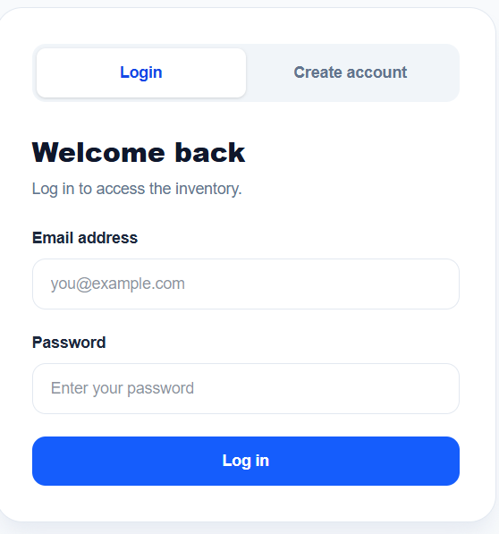

### Register Page
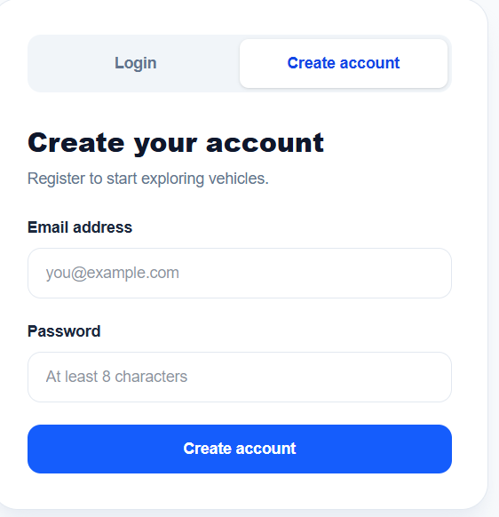

### Admin Login
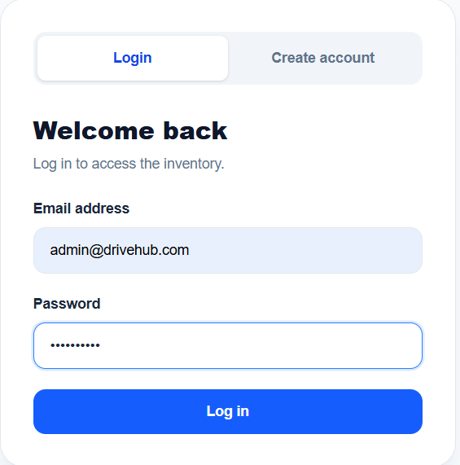

### User Dashboard
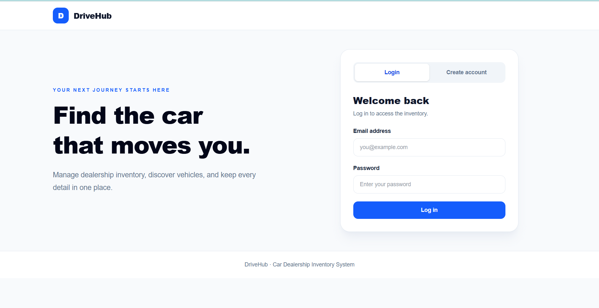

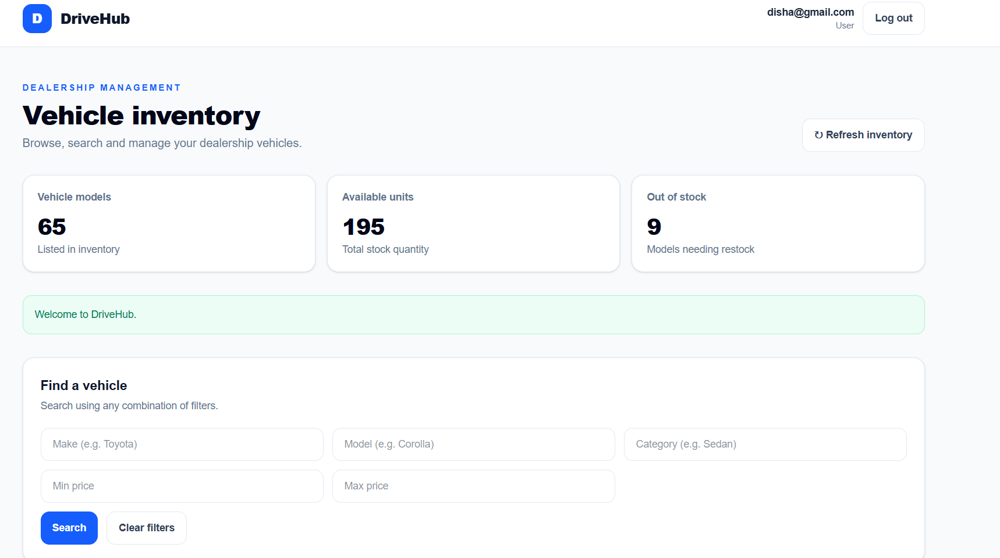


### Search & Filter
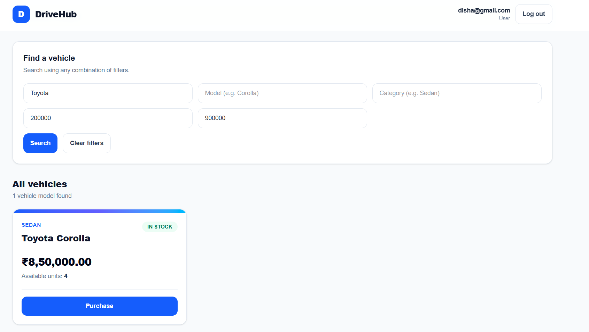

### Purchase Vehicle
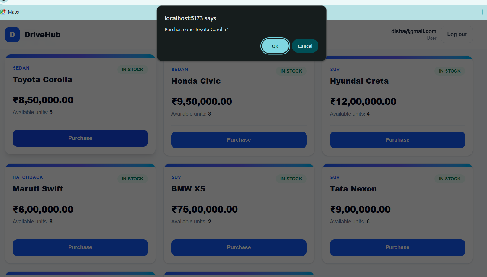

### Admin Dashboard
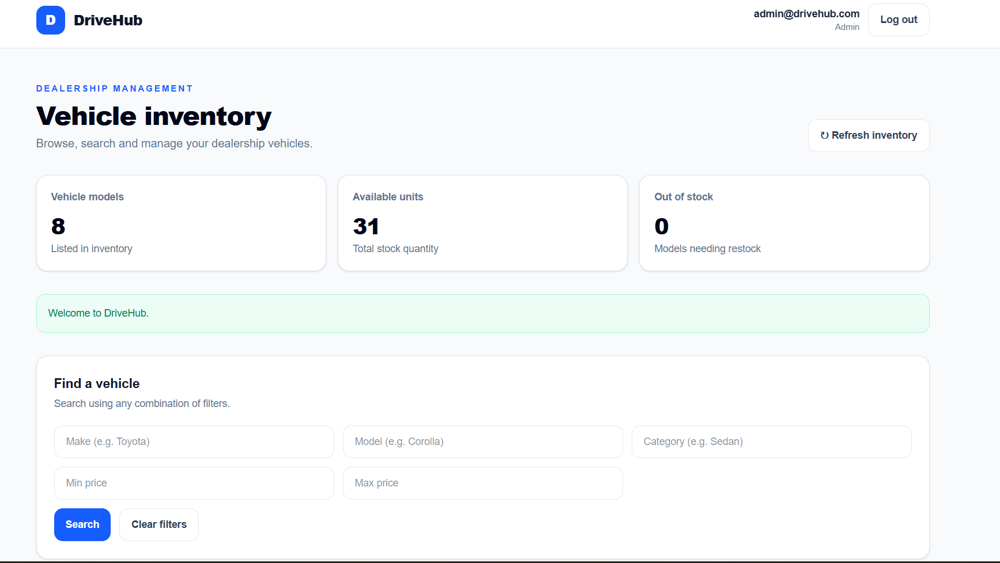


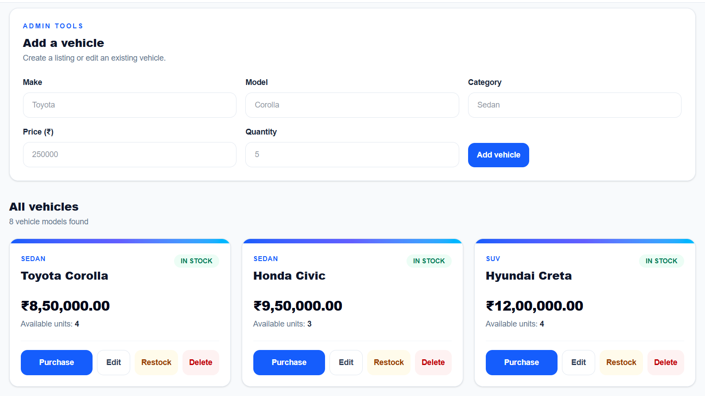

### Admin — Add Vehicle
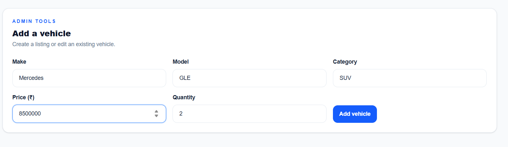

### Admin — Edit Vehicle
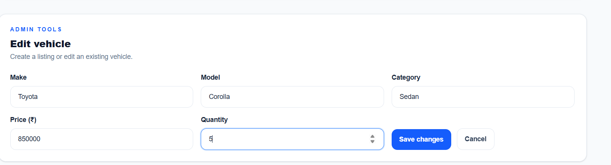

### Admin — Delete Vehicle
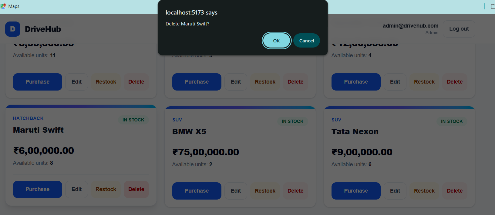

### Admin — Restock Vehicle
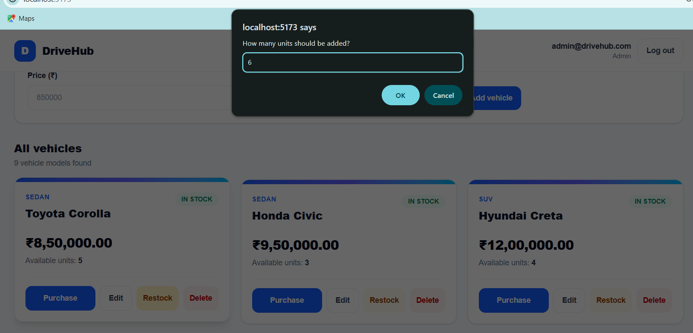

---

## My AI Usage

### Tools Used
- **ChatGPT** — for understanding prerequisites, environment setup, backend and frontend development
- **Kiro** — for documentation, README generation, and debugging errors

### How I Used Them

- **ChatGPT**: Used ChatGPT to understand the project prerequisites and verify that all required tools were installed correctly. It provided commands to check installations (Python, Node.js,etc.), helped with the initial backend setup, and assisted with the React frontend development including UI components, API calls, and structuring the single-page application.

- **Kiro**: Used Kiro IDE's AI assistant to generate the README documentation, identify missing features, troubleshoot errors, and fix bugs that came up during development.

### Reflection

AI tools played a major role in building this project. I used them to generate code, write tests, and set up the project structure. My contribution was in understanding the requirements, directing the AI with the right prompts, testing the application manually, verifying that features worked correctly end-to-end, and debugging issues when things didn't work as expected.

---

## Test Report

See `test-report.txt` in the repository root for the full pytest output.
